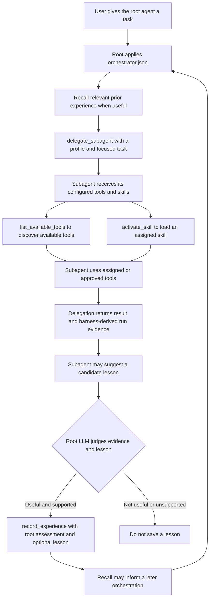

# Project HRNS

Project HRNS is a provider-neutral coding-agent harness that runs in the
codebase you launch it from. Its focus is on making the harness's resources
easy to inspect and configure, and on improving orchestration with recorded
experience and lessons.

## What makes Project HRNS different

- **Inspectable resources:** tools, skills, models, subagents, orchestration,
  memory, and MCP servers are described in JSON files instead of being hidden
  in one large configuration system.
- **Learning orchestration:** optional experience memory lets the root agent
  recall bounded delegation evidence, record assessments, and use lessons to
  improve later orchestration decisions.
- **Provider-neutral core:** providers and terminal interfaces sit behind
  small interfaces, so the agent loop does not depend on one model vendor or
  terminal UI.

## Install and run

Install Project HRNS from a local checkout with either `pip` or `pipx`.
Both methods install the editable source tree, so the installed command uses
the code in that checkout.

### With pip

```sh
python -m pip install -e /path/to/project-hrns
project-hrns init
cd /path/to/your-codebase
project-hrns
```

### With pipx

```sh
pipx install --editable /path/to/project-hrns
project-hrns init
cd /path/to/your-codebase
project-hrns
```

`project-hrns init` resets the user configuration in `~/.project-hrns/` from
the JSON resources in this repository. It replaces the harness configuration
files and registered skills, and resets the user `AGENTS.md` to an empty file.
It preserves `tool-artifacts/` and unrelated files. Run `init` again whenever
you want to reset to the current repository defaults.

> **Warning:** Running `project-hrns init` overwrites the user-level
> `tools.json`, `skills.json`, `subagents.json`, `orchestrator.json`,
> `memory.json`, `mcp.json`, `local_models.json`, and `cloud_models.json` in
> `~/.project-hrns/`. It also clears and reinstalls the registered `skills/`
> directory and replaces `AGENTS.md` with an empty file. Back up any personal
> settings or instructions you want to keep before running it. The command
> preserves `tool-artifacts/` and unrelated files in that directory.

The command uses the current directory as its workspace. Pass
`--working-dir /path/to/your-codebase` to select another workspace. If installed
with pipx and the command is not on `PATH`, run `pipx ensurepath` and restart
your shell.

## JSON resources and configuration

The root JSON files in this repository are the source of truth for
`project-hrns init`. They are copied into `~/.project-hrns/`; the registered
skill resources are copied from `.agents/skills/` into `~/.project-hrns/skills/`.
Only skills listed in `skills.json` are installed.

At runtime, a JSON file in the workspace takes precedence over the matching
file in `~/.project-hrns/`. The workspace file replaces the user file; they are
not merged. The same rule applies to instructions: a workspace `AGENTS.md`
replaces `~/.project-hrns/AGENTS.md` rather than being combined with it. Normal
startup reads configuration but does not create or reset it.

| File | Purpose |
| --- | --- |
| `tools.json` | Native tool definitions, input schemas, and handler mappings. |
| `skills.json` | Registry of skills; `subagents.json` and `orchestrator.json` assign skills to agents. |
| `subagents.json` | Available subagent profiles, their roles, and capabilities. |
| `orchestrator.json` | Root-agent tools, skills, MCP allowlist, and turn limit. |
| `memory.json` | Experience-memory enablement, limits, and write policy. |
| `mcp.json` | MCP server endpoints and non-secret authentication settings. |
| `local_models.json` | Local model servers, API style, and the default local model. The server must already be running. |
| `cloud_models.json` | Cloud providers, their models, and the environment-variable name for each API key. Secrets stay outside JSON. |

Use `/models` to open the model picker, `/models list` to print the catalog,
or `/models provider/model` to select an entry. See the
[configuration reference](docs/configuration-reference.md) for model catalog
examples and detailed file behavior. See the
[native tools and skills guide](docs/Native-Tools-Skills.md) for the built-in
resource inventory.

Environment variables already exported in the shell take priority over values
from `.env`. The workspace `.env` takes priority over `~/.project-hrns/.env`.
Keep credentials out of version control.

## Tools, skills, and orchestration learning

`tools.json` describes the native tools presented to the model; Python
handlers implement their behavior. Tool definitions do not bypass approval or
permission checks. `skills.json` catalogs reusable `SKILL.md` instructions;
agents receive only the skills assigned to them, and skills do not grant extra
tools or permissions.

The root agent delegates focused work through configured subagent profiles.
Experience memory is enabled by default. The root can recall bounded delegation
evidence and lessons, then record a root assessment and an optional lesson after
reviewing a completed delegation. Later runs can use saved lessons without
treating unverified child claims as facts. Set `"enabled": false` in
`memory.json` to disable it.

### Example orchestration workflow



The subagent cannot save orchestration memory. The root decides whether a
candidate lesson is supported and useful; recording stores the root's assessment
with harness-derived evidence. Writes follow the normal execution permissions.

For the detailed subagent and memory behavior, see the
[subagent guide](src/harness/subagents/README.md) and
[experience memory guide](src/harness/memory/README.md). For a walkthrough of
skill loading and tool access, see the
[skill capability walkthrough](docs/skill-capability-walkthrough.md).

## Slash commands

| Command | Description |
| --- | --- |
| `/help` | Show available commands. |
| `/status` | Show the active provider, model, workspace, and runtime settings. |
| `/model [name]` | Show or change the current model. |
| `/models [provider/model]` | Open the model picker, list models, or select one. |
| `/tools` | List registered tools. |
| `/agents` | Show subagent profiles, tools, skills, and delegation activity. |
| `/memory status\|list\|show <id>\|forget <id>` | Inspect experience memory or remove a record. |
| `/mcp add\|list\|remove` | Manage MCP server registrations. |
| `/context` | Show the loaded workspace `AGENTS.md`, if present. |
| `/compact [none\|sliding\|summarize]` | Change conversation compaction. |
| `/clear` | Clear the conversation history. |
| `/exit` or `/quit` | Exit the harness. |

## Development

Create a development environment and install the project with its development
dependencies:

```sh
python -m venv .venv
source .venv/bin/activate
pip install -e '.[dev]'
```

Run the checks with:

```sh
pytest
ruff check src tests
ruff format --check src tests
mypy src
```

The same checks are available through `make check`. See
[`docs/development-phases.md`](docs/development-phases.md) for the detailed
implementation history and phase notes.

## Acknowledgements

This harness was insipired by the workflow of https://www.byoharness.dev/ by BettaTech.
